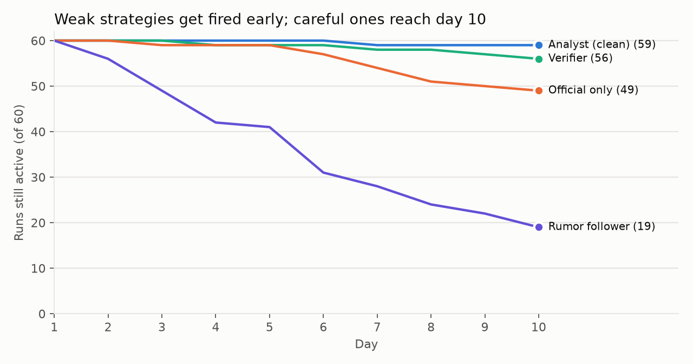
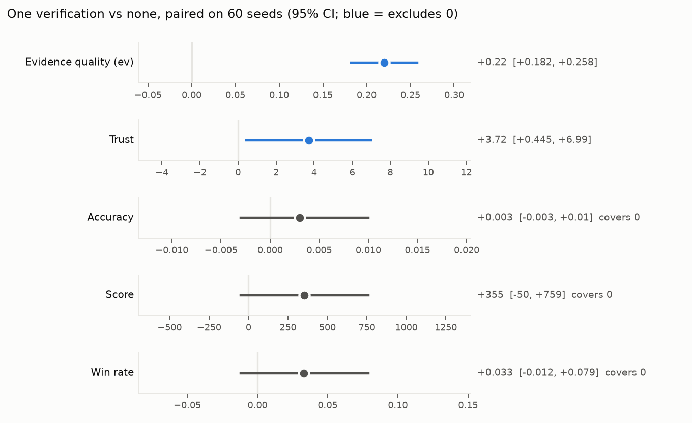
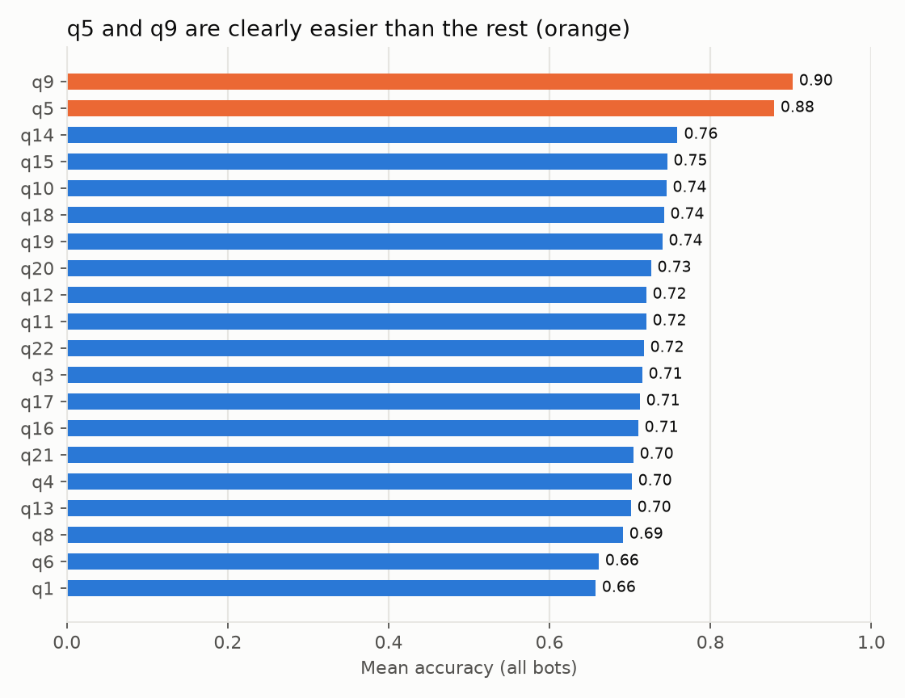

# Case study 1: Data Corp v2 — phễu, chiến lược và độ khó (dữ liệu bot)

Dữ liệu: 780 run (13 bot x 60 seed, 10 ngày), 35.552 sự kiện, validator 0 lỗi. Nguồn là **bot**, không phải người chơi; mọi kết luận chỉ nói về cân bằng game, không nói về hành vi người (giả định A-004). Tái tạo: `tests/telemetry_bots.gd --games=60`, rồi `analyze_playlog.py` và `make_charts.py`.

## Chất lượng dữ liệu
Không run trùng, không run thiếu `run_end`, `acc` trong [0,1], mỗi ngày đủ day_start/day_end/report_submit/wait. 129 run có ít hơn 10 `day_start` — không phải lỗi: đó là run bị sa thải (ending `fired`), xem phễu.

## Kết quả
1. **Phễu theo ngày.** 645/780 run sống sót đến hết (135 bị sa thải, trong đó 129 bị sa thải trước ngày 10). Mất run tập trung ở chiến lược kém: rumor_follower sa thải 44/60, random_reporter 36/60, official_only 12/60, analyst_slow 16/60; careful_hedger 0/60. Analyst sạch chỉ 1/60, analyst không verify 2/60. Tỉ lệ thắng (`won`) tách rất rõ: analyst 90%, verifier 50%, official_only 22%, rumor 8%. → Game phân biệt tốt giữa chơi kỹ và chơi ẩu.

2. **Giá trị của verify (bot đối chứng `analyst_no_verify`).** Verify-first và submit-early vẫn giống hệt nhau (cùng một lần verify hiệu quả). Bot đối chứng bỏ hẳn verify, ghép cặp theo cùng 60 seed, chênh lệch "có một lần verify" trừ "không verify": `ev` **+0,22** (95% CI 0,18–0,26, rõ rệt), `trust` **+3,7** (CI 0,4–7,0, biên), `acc` +0,003 (CI -0,003–0,010, không đổi), điểm +355 (CI -50–759, không kết luận), tỉ lệ thắng +3,3 điểm % (CI -1,2–7,9, không kết luận). Chi phí: báo cáo nộp muộn hơn khoảng 14 phút. → Verify mua được **chất lượng bằng chứng (ev) và một phần trust**, chưa chứng minh được tăng độ chính xác hay tỉ lệ thắng trong bot này; với 60 seed hiệu ứng lên thắng/thua quá nhỏ để thấy.

3. **Áp lực thời gian.** 85% báo cáo đúng hạn, 15% muộn, 0 bị lỡ; tỉ lệ này phẳng theo ngày (15,0–15,7%). Phẳng nghĩa là độ căng thời gian không tăng theo rank/ngày trong bot — nhưng toàn bộ 1.095 báo cáo muộn đến từ hai bot được thiết kế chậm (late_verifier 575, analyst_slow 520; 11 bot còn lại 0) nên chưa kết luận được đồng hồ có quá chặt với người.
4. **Độ khó câu hỏi.** acc trung bình 0,66–0,76 với 18/20 câu; **q5 (0,88) và q9 (0,90) dễ rõ rệt**, q1/q6/q8 khó nhất (0,66–0,69). Chênh lệch giữa câu khó nhất và trung vị chỉ ~0,05, nên chưa có câu nào "bất công". q5/q9 là ứng viên làm khó hơn hoặc kiểm tra lại đáp án (kiểu T-038). Lưu ý acc của bot trộn nhiều chiến lược, chưa tách theo bot.

5. **Retention D1/D7:** chưa làm được — bot không có ngày lịch thật. Cần người chơi thật.

## Giả định và giới hạn
- Bot không đại diện cho người; tỉ lệ thắng/bị sa thải là thước đo cân bằng, không phải hành vi.
- Số seed 60/bot, không có khoảng tin cậy cho so sánh giữa bot (chỉ mô tả).
- Mỗi bot dùng một chiến lược cố định, nên "chiến lược nào tốt" là định nghĩa của bot, không phải khám phá.
- Chưa tách độ khó câu hỏi theo bot hay theo rank.

## Bước tiếp theo
Tách độ khó theo bot (câu 4), tăng số seed lên 200 nếu muốn kết luận về tỉ lệ thắng. Sau khi có người chơi thật (T-042) mới làm retention.
